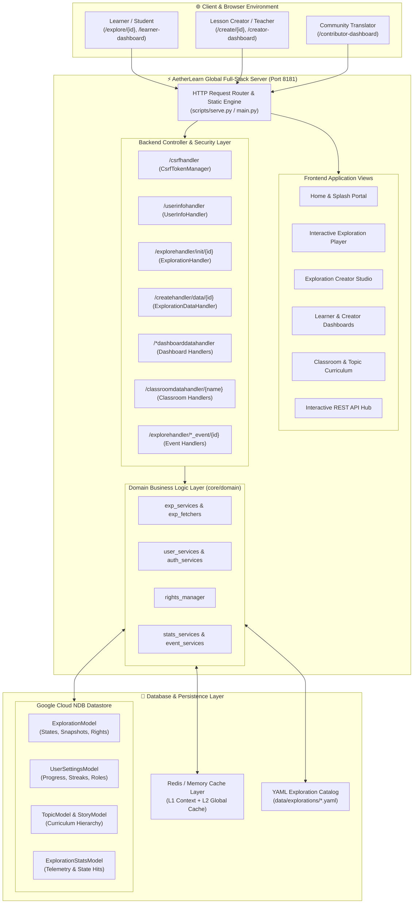
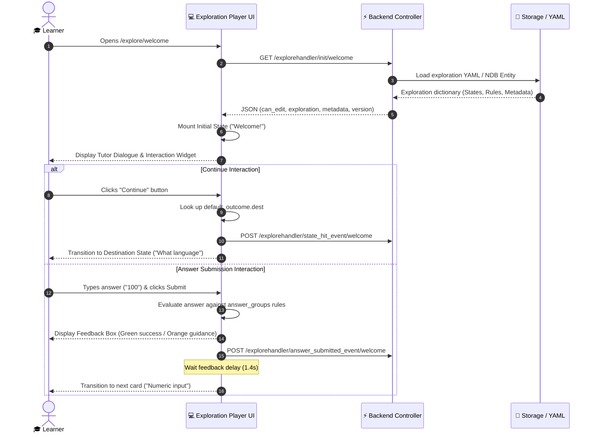
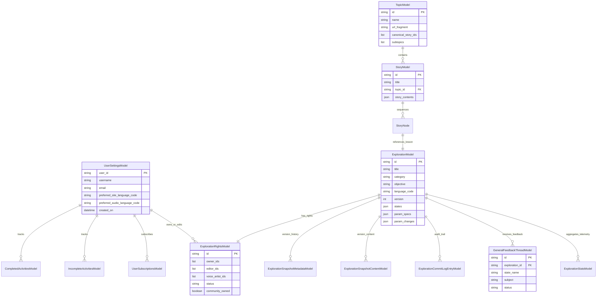

# AetherLearn Global Platform Architecture, Workflows & Database Specification
## Complete Full-Stack Architecture Documentation (`PROJECT_OVERVIEW.md`)

---

## 1. Executive Summary & Ecosystem Anatomy

### 1.1 Purpose & Mission
**AetherLearn Global** is a free, open-source online learning platform designed to provide accessible, scaffolded, and high-quality education to learners across the globe. Inspired by Benjamin Bloom's "Two Sigma Problem" (which observed that one-on-one tutored students perform two standard deviations better than conventionally taught students), AetherLearn Global simulates an interactive, adaptive dialogue with a personal tutor rather than presenting passive lectures.

AetherLearn Global's architecture aligns directly with **UNESCO Sustainable Development Goal 4 (SDG-4: Quality Education)**:
1. **Adaptive Pedagogical Conversations**: Lessons (termed *Explorations*) adapt in real time to learner responses, offering targeted guidance and immediate feedback.
2. **Low-Bandwidth & Inclusive Deployment**: Lightweight client footprint, mobile-optimized card layouts, and offline/audio accessibility.
3. **Open Community Authoring & Crowdsourcing**: Community-driven lesson creation, multi-language localization (Hindi, Spanish, Swahili, Portuguese, Arabic, etc.), and voiceover recording.

---

### 1.2 Technology Stack Overview

| Layer | Technologies & Frameworks | Key Responsibilities |
| :--- | :--- | :--- |
| **Frontend** | Angular 11, TypeScript, HTML5, SCSS, RxJS, FontAwesome | Interactive exploration player, creator studio, dashboards, responsive layouts |
| **Backend** | Python 3 (Python 3.12 / 3.14), Webapp2 WSGI, Gunicorn | Request routing, ACL security, schema validation, domain business logic |
| **Data Layer** | Google Cloud NDB Datastore, Redis, YAML serialization | Schemaless NoSQL entity storage, versioned snapshots, two-level caching |
| **Authentication** | Firebase Auth Emulator, Session Tokens, CSRF Token Manager | User identity, RBAC authorization, secure state modification |
| **Dev Engine** | `scripts/serve.py` (Port 8181) | Standalone development server & API hub with real exploration loading |

---

### 1.3 High-Level System Architecture Diagram



---

## 2. Frontend Architecture & User Experience Workflows

### 2.1 Angular Modular Structure & Routing
AetherLearn Global's frontend utilizes Angular's component-based architecture organized under `core/templates/`. The routing configuration lives in `core/templates/pages/oppia-root/routing/app.routing.module.ts`:
- **`SplashPageModule` (`/`, `/splash`)**: Landing page showcasing featured exploration tracks, community statistics, and educational value propositions.
- **`ExplorationPlayerPageModule` (`/explore/<exploration_id>`)**: The primary learning environment where students interact with tutor cards.
- **`ExplorationEditorPageModule` (`/create/<exploration_id>`)**: Visual authoring studio for structuring states, rules, interactions, and feedback.
- **`LearnerDashboardPageModule` (`/learner-dashboard`)**: Student profile tracking completed lessons, in-progress explorations, study streaks, and playlists.
- **`CreatorDashboardPageModule` (`/creator-dashboard`)**: Authoring management console with exploration play statistics, ratings, and feedback threads.
- **`ContributorDashboardPageModule` (`/contributor-dashboard`)**: Community crowd-sourcing portal for lesson translations, voiceover recordings, and question submissions.
- **`ClassroomPageModule` (`/learn`, `/classroom/<name>`)**: Structured multi-lesson learning paths organized by grade and domain (Fractions, Multiples, Astronomy).

---

### 2.2 The Exploration Player Workflow (Card State Machine)

The **Exploration Player** is the core interactive engine of AetherLearn Global. An Exploration is mathematically a **Directed Graph of States**:
- **Nodes ($S$)**: Individual learning cards (e.g., `Welcome!`, `Estimate 100`, `Numeric input`, `END`).
- **Edges ($E$)**: Transitions governed by learner answer rules (`outcome.dest`).



#### Supported Interaction Types:
1. **`Continue`**: Pauses dialogue, allowing the student to absorb content before clicking a button to proceed.
2. **`NumericInput`**: Accepts integers or floating-point answers, evaluated using rules (`Equals`, `IsLessThan`, `IsGreaterThan`, `IsInclusivelyBetween`).
3. **`MultipleChoiceInput`**: Renders discrete options with custom feedback mapped to each choice.
4. **`TextInput`**: Evaluates strings with exact match, substring (`Contains`), case normalization, or regex rules.
5. **`EndExploration`**: Concluding card displaying exploration completion badge and celebration modal.

---

### 2.3 The Exploration Creator Studio Workflow

The **Creator Studio** provides educators with visual lesson-authoring capabilities:
1. **State Graph Visualizer**: Renders an interactive map of all states, entry points, branching logic, and terminal nodes.
2. **Card Editor**:
   - **Tutor Content Area**: Rich-text HTML editor supporting embedded images, mathematical expressions (LaTeX/MathJax), and interactive widgets.
   - **Interaction Selector**: Configures the response mechanism (Numeric, Multiple Choice, Coding, etc.).
   - **Answer Groups & Rule Builder**: Defines branching conditions (`If answer == X, goto State Y with feedback Z`).
   - **Default Outcome**: Fallback destination and feedback for unexpected answers.
   - **Hint & Solution Drawer**: Authors scaffolded hints and step-by-step solutions for struggling students.
3. **Commit & Versioning Pipeline**:
   - Edits accumulate client-side as an `ExplorationChange` list.
   - On saving, the frontend issues `PUT /createhandler/data/<exploration_id>` with commit message and change list.
   - The backend increments the schema version, generates a diff snapshot, and commits to the datastore.

---

## 3. Backend Architecture & Request Lifecycle

### 3.1 WSGI Pipeline & Request Processing
The backend entry point is configured in `app_dev.yaml` and `main.py`:
- **`gunicorn --bind :$PORT main:app`**
- **`main.py:app`**: Wraps `webapp2.WSGIApplication` inside **`NdbWsgiMiddleware`**, which injects the Google Cloud NDB Datastore client context and Redis cache connection for each incoming thread.

```mermaid
flowchart LR
    Request["Incoming HTTP Request"] --> NdbMiddleware["NdbWsgiMiddleware<br/>(Context & Redis Injector)"]
    NdbMiddleware --> Router["URL Dispatcher<br/>(webapp2 URLS)"]
    Router --> ACL["@acl_decorators<br/>(Authentication & Role Check)"]
    ACL --> SchemaVal["HANDLER_ARGS_SCHEMAS<br/>(Type & Regex Validation)"]
    SchemaVal --> Handler["Controller Action<br/>(e.g., ExplorationHandler.get)"]
    Handler --> DomainLayer["Domain Service Layer<br/>(exp_services, user_services)"]
    DomainLayer --> Response["JSON / HTML Response Render"]
```



---

### 3.2 Security, ACL & CSRF Protection
Every request handler inherits from `core.controllers.base.BaseHandler`:
1. **CSRF Enforcement**: Non-GET state-mutating requests require a valid `X-CSRF-Token` issued by `/csrfhandler`.
2. **Role-Based Access Control (RBAC)** via `@acl_decorators`:
   - `@acl_decorators.open_access`: Public endpoints (Splash, Library index, Login).
   - `@acl_decorators.can_play_exploration`: Verifies exploration exists and is accessible.
   - `@acl_decorators.can_edit_exploration`: Restricts authoring actions to owners or curriculum admins.
   - `@acl_decorators.can_access_creator_dashboard`: Ensures authenticated creator profile exists.
3. **Schema Validation**: Every endpoint defines strict `HANDLER_ARGS_SCHEMAS` and `URL_PATH_ARGS_SCHEMAS` preventing SQL/NoSQL injection, unexpected payload keys, or malformed data.

---

## 4. Database & Storage Architecture

### 4.1 Storage Technology: Google Cloud NDB Datastore
AetherLearn Global uses **Google Cloud NDB Datastore**, a schemaless NoSQL document store that provides high scalability, strong consistency for key lookups, and transaction support.

### 4.2 Entity Relationship Diagram (ERD)



---

### 4.3 Core Data Models Detail

#### 1. `ExplorationModel` (`core/storage/exploration/gae_models.py`)
- **Key**: Exploration ID string (e.g. `'welcome'`, `'multiples'`, `'solar_system'`).
- **Fields**:
  - `title`, `category`, `objective`, `language_code`.
  - `states`: Structured JSON dictionary containing all state cards, rich text contents, interaction customization arguments, answer groups, and feedback rules.
  - `version`: Integer tracking sequential revisions.
  - `auto_tts_enabled`: Boolean enabling text-to-speech voiceovers.

#### 2. `UserSettingsModel` (`core/storage/user/gae_models.py`)
- **Key**: User ID string.
- **Fields**:
  - `username`, `email`.
  - `preferred_site_language_code`, `preferred_audio_language_code`.
  - `roles`: Assigned RBAC role list (`LEARNER`, `EXPLORATION_EDITOR`, `CURRICULUM_ADMIN`, `TOPIC_MANAGER`).

#### 3. `TopicModel` & `StoryModel` (`core/storage/topic/`, `core/storage/story/`)
- Represent structured curriculums:
  - A **Classroom** consists of multiple **Topics** (e.g. Fractions).
  - A **Topic** consists of curated **Stories**.
  - A **Story** consists of sequential **Nodes**, each linking to an `ExplorationModel`.

#### 4. Caching Hierarchy
AetherLearn Global implements a **two-level caching architecture**:
- **Level 1 (In-Memory Context Cache)**: Caches entities retrieved within the scope of a single WSGI request thread.
- **Level 2 (Redis Global Cache)**: Shared across processes and instances on port `6379`, caching serialized exploration dicts, user session records, and summary dictionaries.

---

## 5. Complete REST API Contract Matrix

| Endpoint | HTTP Method | Auth / Access | Purpose & Response Schema |
| :--- | :--- | :--- | :--- |
| `/csrfhandler` | `GET` | Open | Returns `{"token": string}` for CSRF protection |
| `/userinfohandler` | `GET` | Open | Returns current user identity, roles, email, and preferences |
| `/explorehandler/init/<id>` | `GET` | Learner / Open | Returns full exploration state tree, metadata, session ID, and version |
| `/explorehandler/answer_submitted_event/<id>` | `POST` | Learner | Telemetry endpoint recording submitted answer and returning feedback outcome |
| `/explorehandler/state_hit_event/<id>` | `POST` | Learner | Records card transition event |
| `/explorehandler/state_complete_event/<id>` | `POST` | Learner | Records card completion event |
| `/createhandler/data/<id>` | `GET` | Author / Admin | Returns complete authoring schema, state graph, and parameters |
| `/createhandler/data/<id>` | `PUT` | Author / Admin | Commits draft changes, updates exploration states, and increments version |
| `/learnerdashboarddatahandler` | `GET` | Learner | Returns lists of completed, in-progress explorations, and active goals |
| `/creatordashboarddatahandler` | `GET` | Author | Returns authored exploration metrics, total plays, and feedback threads |
| `/contributordashboarddatahandler` | `GET` | Contributor | Returns translation, voiceover, and question contribution opportunities |
| `/classroomdatahandler/<name>` | `GET` | Open | Returns curriculum topics, subtopics, and story lessons |
| `/libraryindexhandler` | `GET` | Open | Returns categorized exploration library groups (Top Rated, Featured) |
| `/api/docs` | `GET` | Developer | Interactive REST API tester and live documentation playground |

---

## 6. Step-by-Step Prompt & Execution Plan for Step 3 (UNESCO UI/UX Transformation)

### 6.1 Transformation Directive & Constraints
As specified in `D:\PROJECT_S\Steps to Do in the GitHub projects.txt`:
- **Core Principle**: Do **not** alter the backend architecture or backend REST APIs. All backend contracts, data structures, and endpoints remain stable.
- **Goal**: Overhaul the frontend UI/UX into a modern, futuristic, UNESCO-aligned social service educational application.

---

### 6.2 Master Prompt for Step 3 Execution
The following prompt is ready to be provided to Antigravity to execute Step 3:

```text
Read the project architecture and workflow guide in PROJECT_OVERVIEW.md carefully.
Transform the frontend web application as per the following requirements (Do not change backend APIs or contracts):

1. UI/UX THEME OVERHAUL:
   - Redesign the application with a modern, futuristic, and inspiring UNESCO-themed visual design system.
   - Use a purposeful color palette: Deep Ocean Teal (#0A4D4A), Vibrant Mint (#00C49F), Clean Pearl Surface (#FAFCFB), Warm Amber Gold (#F59E0B) for achievements, and sleek dark card elevations.
   - Incorporate modern glassmorphism, refined micro-interactions, smooth card transitions, and elegant typography.

2. APPLICATION REBRANDING:
   - Rebrand the frontend application to "AetherLearn Global — UNESCO Open Learning Initiative".
   - Highlight the mission: Free, high-impact, barrier-free interactive tutoring for learners worldwide.

3. COMPONENT & UX ENHANCEMENTS:
   - Modernize the Exploration Player: sleek card carousel, interactive progress rings, animated feedback banners, and audio accessibility controls.
   - Elevate the Learner Dashboard: daily learning streaks, mastery skill trees, interactive achievement badges, and smart lesson recommendations.
   - Elevate the Creator Studio: modern visual state-graph editor with draggable cards, rich WYSIWYG preview, and instant validation checks.
   - Elevate the Contributor Portal: global impact map showing community translations and voiceover contributions across continents.

4. SEAMLESS BACKEND INTEGRATION:
   - Connect all frontend views to the active REST APIs (/csrfhandler, /userinfohandler, /explorehandler/init/*, /createhandler/data/*, /learnerdashboarddatahandler, /creatordashboarddatahandler, etc.).
   - Ensure dynamic data loading, smooth error handling, and 100% bug-free responsiveness across desktop and mobile.
```
